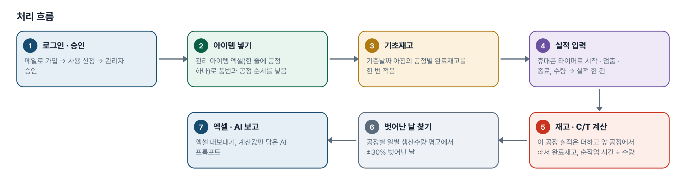
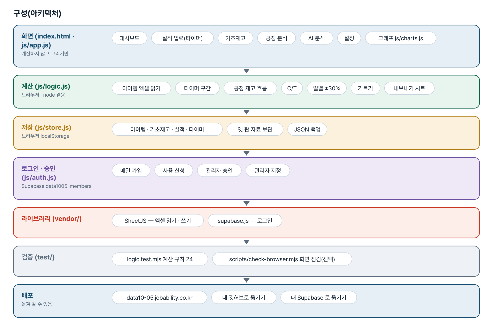
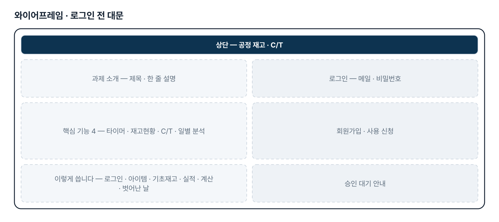
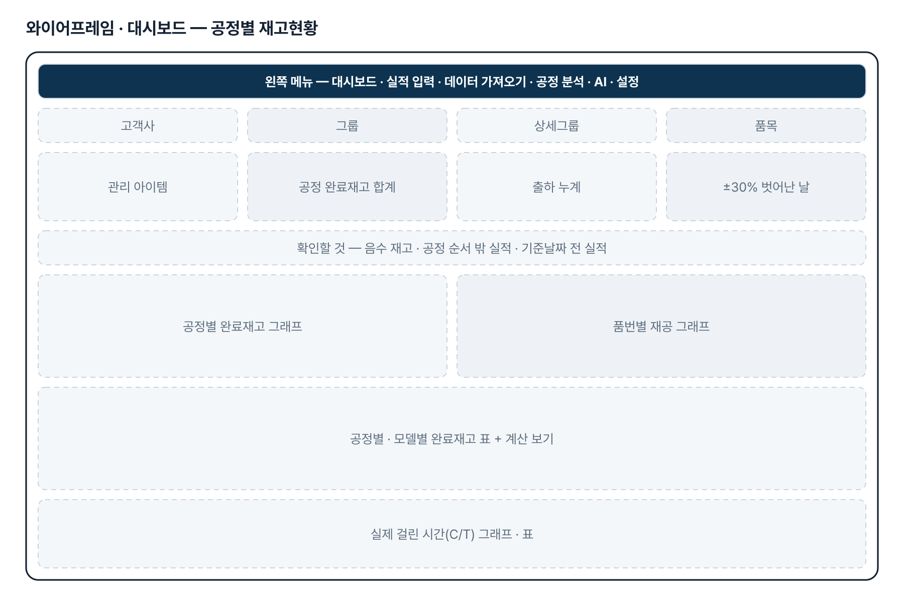
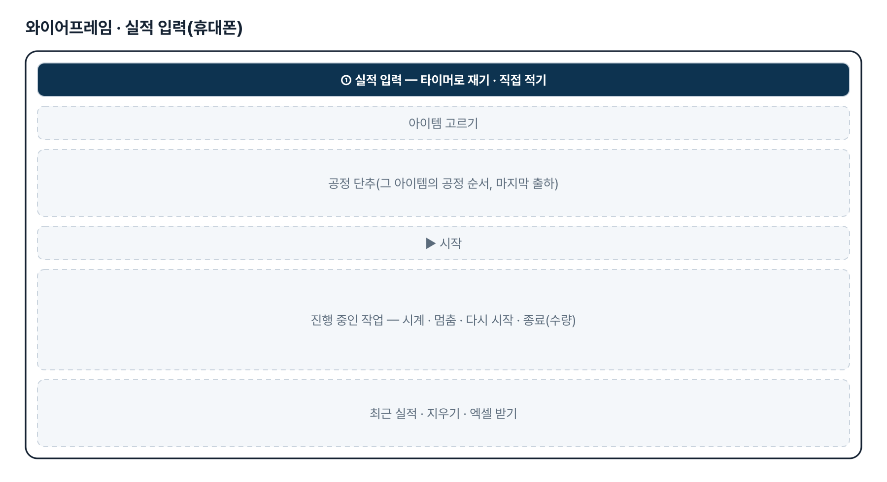
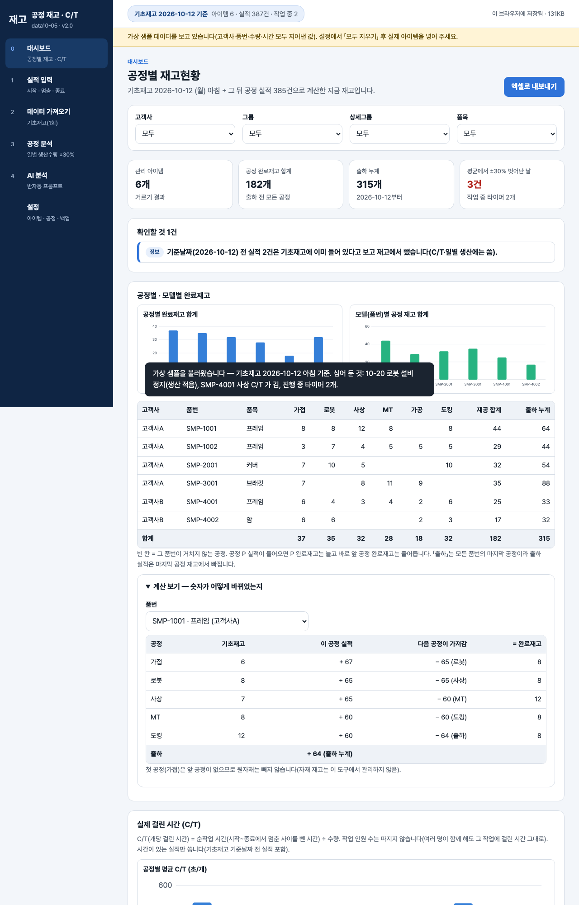

# 공정 재고 · C/T — 프로젝트 기획서 v2.0

- 기획: 박주헌 · 작성일 2026-11-10 · 현장 데이터 디지털화 전문가과정 · 2차수 프로젝트 05
- 바로 쓰기: https://data10-05.jobability.co.kr/
- 워드 판: `docs/기획서/data10-05_박주헌_공정재고CT_기획서_v2.0.docx`

## 개요

기초재고를 한 번 적고 현장에서 공정 실적(시작 · 멈춤 · 다시 시작 · 종료)을 넣으면 아이템 · 공정별 지금 재고, 실제 걸린 시간(C/T), 공정별 일별 생산수량을 보여 주는 도구입니다.

### 배경 · 현재 업무
- 계획운영팀은 생산이 어디까지 왔는지와 공정별 재고를 매일 확인해야 합니다.
- 현장 실적이 바로 전산에 들어오지 않고, 재고현황은 수기에서 엑셀로 옮겨 적는 수준입니다.
- 처음 요청은 고객사 발주서 · 납품이력까지 묶은 생산진도율 자동화였으나, 3차(10-27 요청)에서 「기초재고 + 실적 → 공정별 재고현황」으로 범위를 좁혔습니다.
- 공정마다 실제로 걸린 시간(C/T)은 기록이 없어 감으로 판단하고 있었습니다.

### 목표
- 현장 휴대폰에서 타이머로 공정 실적을 바로 남깁니다.
- 기초재고 + 공정 실적으로 아이템 · 공정별 지금 재고를 자동으로 계산하고, 계산 과정을 표로 보여 줍니다.
- 순작업 시간으로 개당 C/T 를 내고, 평균에서 30% 이상 벗어난 날을 찾아 줍니다.
- 실제 관리 아이템 목록 엑셀을 모양 그대로 넣고 받습니다.

## 요구사항과 구현

| 기획서 요구 | 구현 |
|---|---|
| 실적 현장 전산입력 | 휴대폰 실적 입력 — 타이머(start · stop · restart · end, 새로고침에도 이어짐)와 직접 적기 |
| 출하 대비 재고현황 자동 산출(3차: 기초재고 + 실적 → 공정별 재고현황) | 기초재고 + 이 공정 실적 − 다음 공정이 가져감 = 완료재고, 대시보드 표 · 그래프 · 「계산 보기」 |
| 공정별 실적 분석 | 공정별 일별 생산수량 · 일 평균 · 평균에서 ±30% 벗어난 날(많음 · 적음)과 그날 실적, 공정별 C/T |
| 출하도 공정 실적으로 입력(10-30 답) | 「출하」를 모든 아이템의 마지막 공정으로 자동으로 붙이고 출하 실적은 마지막 공정 재고에서 뺌 |
| 첫 공정 원자재 재고는 고려하지 않음 · 공정당 인원은 따지지 않음(10-30 답) | 첫 공정은 앞 공정 차감 없음, C/T 는 작업 인원 수와 관계없이 순작업 시간 ÷ 수량 |
| 실제 관리 아이템 목록 그대로 넣기(10-30 첨부) | 한 줄에 공정 하나 모양 엑셀 읽기 · 받기, 옛 「공정 순서」 한 칸 양식도 읽음 |
| 고객사 발주서 · 납품이력 자동 다운로드 | 3차 범위 재설정으로 뺐습니다(고객사 포털 확인 뒤 다시 검토) |
| 여러 휴대폰 실적을 한곳에 | 2단계 — 지금은 이 브라우저에 저장, 엑셀로 받기 |

## 주요 기능

- **타이머 실적 입력** — 아이템 · 공정을 골라 시작 · 멈춤 · 다시 시작 · 종료, 종료 때 수량을 적으면 실적 한 건이 됩니다.
- **공정별 재고현황** — 기초재고와 실적으로 아이템 · 공정별 완료재고를 계산하고, 「계산 보기」로 더하고 뺀 과정을 보여 줍니다.
- **실제 걸린 시간(C/T)** — 멈춘 시간을 뺀 순작업 시간 ÷ 수량으로 개당 C/T 를 내고 공정 평균보다 30% 긴 것을 표시합니다.
- **일별 생산수량 분석** — 공정별 일별 생산수량과 평균, 평균에서 30% 이상 벗어난 날과 그날의 실적을 보여 줍니다.
- **관리 아이템 엑셀** — 고객사 · 그룹 · 상세그룹 · 품목 · 품번 · 비고 · 공정을 한 줄에 공정 하나 모양으로 넣고 받습니다.
- **기초재고** — 기준날짜 아침의 아이템 × 공정 완료재고를 화면이나 엑셀 양식으로 한 번 넣습니다.
- **AI 분석(반자동)** — 계산된 재고 · C/T · 벗어난 날만 담은 프롬프트(품번 · 고객사 별칭)를 복사합니다.
- **엑셀 내보내기 · 백업** — 공정별 재고현황 · C/T · 일별 · 실적 시트로 내보내고 JSON 으로 백업합니다.
- **로그인 · 사용 승인** — 회사 메일이나 개인 메일로 가입해 사용 신청, 관리자가 승인하면 씁니다.

## 처리 흐름(파이프라인)

1. **로그인 · 승인** — 메일로 가입 → 사용 신청 → 관리자 승인
2. **아이템 넣기** — 관리 아이템 엑셀(한 줄에 공정 하나)로 품번과 공정 순서를 넣음
3. **기초재고** — 기준날짜 아침의 공정별 완료재고를 한 번 적음
4. **실적 입력** — 휴대폰 타이머로 시작 · 멈춤 · 종료, 수량 → 실적 한 건
5. **재고 · C/T 계산** — 이 공정 실적은 더하고 앞 공정에서 빼서 완료재고, 순작업 시간 ÷ 수량
6. **벗어난 날 찾기** — 공정별 일별 생산수량 평균에서 ±30% 벗어난 날
7. **엑셀 · AI 보고** — 엑셀 내보내기, 계산값만 담은 AI 프롬프트

## 구성(아키텍처)

- **화면 (index.html · js/app.js)** — 대시보드 · 실적 입력(타이머) · 기초재고 · 공정 분석 · AI 분석 · 설정 · 그래프 js/charts.js
- **계산 (js/logic.js)** — 아이템 엑셀 읽기 · 타이머 구간 · 공정 재고 흐름 · C/T · 일별 ±30% · 거르기 · 내보내기 시트
- **저장 (js/store.js)** — 아이템 · 기초재고 · 실적 · 타이머 · 옛 판 자료 보관 · JSON 백업
- **로그인 · 승인 (js/auth.js)** — 메일 가입 · 사용 신청 · 관리자 승인 · 관리자 지정
- **라이브러리 (vendor/)** — SheetJS — 엑셀 읽기 · 쓰기 · supabase.js — 로그인
- **검증 (test/)** — logic.test.mjs 계산 규칙 24 · scripts/check-browser.mjs 화면 점검(선택)
- **배포** — data10-05.jobability.co.kr · 내 깃허브로 옮기기 · 내 Supabase 로 옮기기

## 화면 구성(와이어프레임)

## 규칙 · 판정 기준

- 공정 P 실적 q → P 완료재고 + q, 그 아이템 공정 순서의 바로 앞 공정 − q.
- 첫 공정은 앞 공정에서 빼지 않습니다(원자재 재고는 다루지 않음 — 10-30 답).
- 「출하」는 모든 아이템의 마지막 공정입니다. 출하 실적은 마지막 공정 재고에서 빼고 출하 누계에 더합니다.
- 기초재고는 기준날짜 아침 값입니다. 기준날짜 당일부터의 실적만 재고에 넣고, 그 전 실적은 C/T 에만 씁니다.
- C/T = 순작업 시간(시작~종료에서 멈춘 사이를 뺀 시간) ÷ 수량. 작업 인원 수는 따지지 않습니다(10-30 답).
- 일별 생산수량이 그 공정 평균에서 30% 이상(경계 포함) 벗어나면 많음 · 적음으로 표시합니다.

## 검증

- 계산 규칙 테스트 24개 통과
- node test/logic.test.mjs 24개 통과(2026-11-10).
- 3차 때 앞 공정 차감 · 출하 차감 · 기준날짜 당일 포함 · 멈춘 시간 빼기 · ±30% 경계를 일부러 깨뜨려 테스트가 잡는 것을 확인했습니다.
- 4차 때 옛 코드에 새 테스트를 돌리면 아이템 엑셀 4개가 실패하는 것을 확인했습니다.
- 화면 점검 scripts/check-browser.mjs(선택) — 6개 화면 × 1280 · 390px 가로 넘침 · 외부 요청 0.

## 이번 판에서 하지 않는 것

- 업무 자료(아이템 · 기초재고 · 실적)는 아직 팀 공유 DB 가 아니라 이 브라우저에 저장됩니다. 여러 휴대폰 실적은 엑셀로 모아야 합니다.
- 고객사 발주서 · 납품이력 자동 다운로드와 생산진도율은 3차 범위 재설정으로 뺐습니다.
- 원자재 재고와 작업 인원 수는 계산에 넣지 않습니다.
- AI 는 도구가 직접 부르지 않는 것이 기본입니다(프롬프트 복사 · 붙여 넣기).

## 다음 단계

- 실적 공유 저장 — 여러 휴대폰 실적을 한곳에(팀 공유 DB)
- 공유 저장 뒤 같은 공장 다른 과제와 실적 형식 맞추기
- 필요하면 고객사 포털 발주서 연동을 다시 검토

## 버전 이력

- **v2.0** (2026-11-10) — 최종 기획서 — 파이프라인 · 아키텍처 · 와이어프레임 정리 / 로그인 · 사용 신청 · 관리자 승인(요청자 Supabase 로 옮길 수 있게) / 로그인 전 대문
- **v1.3** (2026-11-08) — 4차 — 실제 관리 아이템 목록 모양(한 줄에 공정 하나) 그대로 넣기 · 받기 / 출하 · C/T · 첫 공정 안내 확정(10-30 답)
- **v1.2** (2026-10-28) — 3차 범위 재설정 — 기초재고 + 공정 실적 → 공정별 재고현황 / 타이머 C/T · 일별 생산수량 ±30% · 계산 보기, 재고 과부족 · 진도율 페이지 삭제
- **v1.1** (2026-10-21) — 2차 — 실제 재고 체크 · 포털 발주서 양식 읽기, 재고 체크 입력 화면, 안전재고 산식
- **v1.0** (2026-10-20) — 1단계 — 실적 입력 · 엑셀 가져오기 · 재고 과부족 · 진도율 · 공정 투입조정
